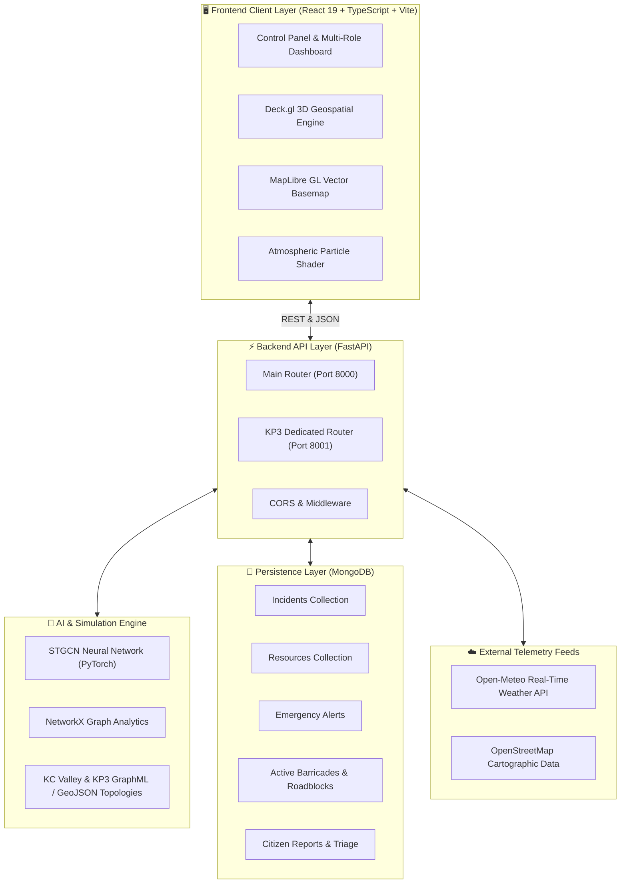

<div align="center">

# 🚨 EvacX / CrisisFlow
### **Next-Generation 3D Digital Twin Crisis Command & Flood AI Forecasting Platform**

*A Living Geospatial City Replica Powered by Spatio-Temporal Graph AI (STGCN), Real-Time Open-Meteo Weather Telemetry, and Multi-Agency Tactical Operations.*

<br/>

[](https://react.dev/)
[](https://www.typescriptlang.org/)
[](https://vitejs.dev/)
[](https://fastapi.tiangolo.com/)
[](https://python.org)
[](https://pytorch.org/)
[](https://www.mongodb.com/)
[](https://deck.gl/)
[](LICENSE)

<br/>

</div>

---

## 📖 Executive Summary

During severe hydrometeorological disasters—such as flash floods and urban inundations—emergency response fails due to fragmented communication, static 2D maps, and delayed situational awareness.

**EvacX** transforms disaster coordination by rendering an **active, real-time 3D Digital Twin of the city**. It directly merges **high-resolution geospatial building footprints (OpenStreetMap)**, **live atmospheric precipitation feeds (Open-Meteo API)**, and a **Spatio-Temporal Graph Convolutional Network (STGCN)** to simulate, predict, and visualize flood propagation up to hours in advance. Emergency stakeholders (Government Administration, Police, Hospitals, Fire & Rescue, and Citizens) coordinate through role-tailored tactical command portals on a unified geospatial data fabric.

---

## 📸 Platform Showcase

<div align="center">

| **3D Digital Twin Command Center** | **AI Flood Propagation Heatmap** |
|:---:|:---:|
|  |  |

| **Multi-Agency Operations & Dynamic Route Optimization** |
|:---:|
|  |

</div>

---

## ✨ Core Pillars & Architectural Capabilities

### 1. 🌐 Real-Time 3D Digital Twin Engine
- **Authentic Geospatial Topography**: Built directly on OpenStreetMap geometry with 3D extruded building polygons, water bodies, and road network topologies.
- **Dual-Engine Visualization**: High-performance WebGL rendering via **Deck.gl v9** combined with vector tile cartography via **MapLibre GL**.
- **Interactive 2D/3D Orthographic & Perspective Switching**: Smooth 60FPS transitions between high-altitude tactical 2D mapping and street-level 3D perspective analysis.
- **Dynamic Multi-Layer Stacking**: Stack building footprints, road graphs, live rainfall radar, flood depth contours, and active responder markers seamlessly.

### 2. 🧠 STGCN Spatio-Temporal Deep Learning AI Engine
- **Graph Neural Network Formulation**: City road and drainage infrastructure is modeled as a connected graph $G = (V, E)$, where vertices represent critical road intersections/catchment zones and edges represent water drainage conduits.
- **Spatio-Temporal Graph Convolutions (ST-Conv Blocks)**: Integrates Spatial Graph Convolutions (capturing topological spatial water spread) with 1D Gated Temporal Convolutions (capturing temporal rainfall accumulation over time).
- **Zero-Latency Real-Time Inference**: Computes forward-pass hydrodynamic water spread across thousands of graph nodes in sub-100ms.

### 3. 🛰️ Live Environmental & Weather Telemetry
- **Continuous Ingestion**: Live precipitation and rainfall feeds fetched from Open-Meteo API on automated 30-second polling cycles.
- **Atmospheric Particle Shaders**: Dynamic on-canvas particle rain simulation reacting directly to current precipitation intensity and storm severity.

### 4. 🛣️ Risk-Aware Dynamic Evacuation & Routing
- **Water-Repellent Dijkstra / Graph Pathfinding**: Computes safe routes for emergency vehicles (Ambulances, Fire Engines, Police Patrols) by dynamically penalizing and circumventing waterlogged or flooded road segments.
- **Automated Nearest Facility Discovery**: One-click algorithm to find the closest non-flooded trauma center, fire station, police station, or flood shelter.
- **Dynamic Obstacle & Barricade Injection**: Responders can place real-time roadblocks and cordons directly on the map, forcing live path recalculations for all en-route units.

### 5. 👥 Multi-Agency Command Dashboards
Each stakeholder role features specialized telemetry, permissions, and operational capabilities:
- 🏛 **Government (BBMP / District Control)**: Macroscopic city overview, district vulnerability metrics, inter-agency resource orchestration, high-priority emergency broadcast issuance.
- 🛡 **Police Command**: Traffic diversion protocols, perimeter cordon management, roadblock deployment, evacuation route enforcement.
- 🏥 **Hospital Network & EMS**: Real-time trauma center ICU/general bed capacity, patient triage sessions, ambulance fleet telemetry and routing.
- 🚒 **Fire & Rescue**: Incident dispatch, equipment tracking (pumps, rescue rafts, heavy rescue vehicles), active water extraction deployments.
- 👤 **Citizen Safety Portal**: Live SOS panic reporting, verified hazard map, crowd-sourced incident submissions with geolocation tagging.

### 6. 🏙️ Multi-City Digital Twin Support
- **Bangalore (KC Valley Basin)**: Covering Koramangala, HSR Layout, Bellandur, Agara Lake catchment basin.
- **Greater Noida (Knowledge Park 2 & 3 / Pari Chowk)**: Dedicated STGCN engine and infrastructure mapping for institutional and educational zones.

---

## 🏗️ System Architecture



---

## 💻 Technology Stack

| Layer | Technology | Version | Purpose |
| :--- | :--- | :--- | :--- |
| **Frontend Framework** | React | `v19.2.5` | Reactive Component Architecture & State Management |
| **Language (UI)** | TypeScript | `v5.x` | Static Type Safety across geospatial interfaces |
| **Build Tooling** | Vite | `v8.0.11` | Ultra-fast HMR and optimized production bundling |
| **Geospatial 3D** | Deck.gl | `v9.3.2` | WebGL-accelerated 3D polygon & layer rendering |
| **Map Rendering** | MapLibre GL / React-Map-GL | `v5.24.0` | Open-source vector tile cartographic basemaps |
| **Icons & Design** | Lucide React / Vanilla CSS | `Latest` | Custom Glassmorphism UI & Cyberpunk-tactical design |
| **Backend Framework**| FastAPI | `v0.110+` | High-throughput asynchronous REST API |
| **Language (API)** | Python | `3.10+ / 3.11` | Backend logic and deep learning inference |
| **Deep Learning** | PyTorch | `v2.x` | STGCN neural network implementation |
| **Graph Computation**| NetworkX / OSMnx | `Latest` | Spatial topological graph processing & routing |
| **Database** | MongoDB + Motor | `v4.x+` | Asynchronous NoSQL database for emergency operations |
| **Weather Feeds** | Open-Meteo API | `REST` | Real-time global precipitation and rainfall telemetry |

---

## 🚀 Step-by-Step Installation & Run Guide

Follow these instructions to set up, configure, and execute the complete EvacX platform locally.

### 📋 Prerequisites

Before starting, ensure you have the following installed on your operating system:
- **Node.js**: `v18.0.0` or higher (`v20+` recommended)
- **Python**: `3.10` or `3.11`
- **MongoDB**: Community Server running locally on `localhost:27017` or a [MongoDB Atlas](https://www.mongodb.com/atlas) connection URI
- **Git**: Installed and configured

---

### Step 1: Clone the Repository

```bash
git clone https://github.com/Abbas-sp3/FloodEffect.git
cd FloodEffect
```

---

### Step 2: Ensure MongoDB is Running

Verify your local MongoDB daemon is active:

**Windows (PowerShell):**
```powershell
Get-Process mongod -ErrorAction SilentlyContinue
# If not running, start it:
net start MongoDB
```

**macOS / Linux:**
```bash
sudo systemctl status mongod
# or with Homebrew:
brew services start mongodb-community
```

---

### Step 3: Backend Setup (FastAPI + STGCN Engine)

1. **Navigate to the backend directory:**
   ```bash
   cd backend
   ```

2. **Create and activate a Python virtual environment:**
   ```bash
   # Windows
   python -m venv .venv
   .\.venv\Scripts\activate

   # macOS / Linux
   python3 -m venv .venv
   source .venv/bin/activate
   ```

3. **Install Python dependencies:**
   ```bash
   pip install --upgrade pip
   pip install -r requirements.txt
   ```

4. **Configure Environment Variables:**
   Copy the `.env.example` file to create `.env`:
   ```bash
   # Windows PowerShell
   Copy-Item .env.example .env

   # macOS / Linux
   cp .env.example .env
   ```

   Ensure your `.env` contains:
   ```ini
   MONGODB_URL=mongodb://localhost:27017
   DATABASE_NAME=evacx
   WEATHER_API_URL=https://api.open-meteo.com/v1/forecast?latitude=12.935&longitude=77.645&current=rain,precipitation&timezone=Asia/Kolkata
   STGCN_MODEL_PATH=./stgcn_checkpoint.pth
   API_HOST=0.0.0.0
   API_PORT=8000
   ```

5. **Start the Main Backend API:**
   ```bash
   python main.py
   ```
   *The unified backend will start on **`http://localhost:8000`**, automatically connect to MongoDB, build spatial indexes, seed baseline emergency data, and load the STGCN PyTorch neural model into memory.*

---

### Step 4: (Optional) Start Dedicated Knowledge Park 3 Engine

If you want to simulate and explore the **Greater Noida (KP2 & KP3)** digital twin alongside Bangalore:

Open a new terminal:
```bash
cd backend/knowledge_park_3
# Activate the same virtual environment
..\.venv\Scripts\activate   # On Windows
# source ../.venv/bin/activate # On Linux/macOS

python run_kp3.py
```
*The KP3 dedicated engine runs on **`http://localhost:8001`**.*

---

### Step 5: Frontend Setup (React 19 + Deck.gl Command Center)

1. **Open a new terminal window and navigate to the frontend directory:**
   ```bash
   cd frontend
   ```

2. **Install Node.js dependencies:**
   ```bash
   npm install
   ```

3. **Configure Frontend Environment Variables:**
   Copy the `.env.example` file:
   ```bash
   # Windows PowerShell
   Copy-Item .env.example .env

   # macOS / Linux
   cp .env.example .env
   ```

4. **Start the Vite Development Server:**
   ```bash
   npm run dev
   ```
   *The frontend dashboard will compile and launch on **`http://localhost:5173`**.*

---

### Step 6: Verify Active Services

Open your web browser and test all running endpoints:

| Service | Access URL | Health Verification |
| :--- | :--- | :--- |
| **EvacX 3D Command Center** | [http://localhost:5173](http://localhost:5173) | Web Dashboard Loads |
| **Unified Backend API** | [http://localhost:8000](http://localhost:8000) | Returns service catalog |
| **Backend Health Check** | [http://localhost:8000/health](http://localhost:8000/health) | `{"status":"healthy","database":"connected","stgcn":"loaded"}` |
| **Interactive API Docs (Swagger)** | [http://localhost:8000/docs](http://localhost:8000/docs) | Interactive API Explorer |
| **KP3 Engine Health Check** | [http://localhost:8001/health](http://localhost:8001/health) | `{"status":"healthy","stgcn":"active"}` |

---

## 📡 Comprehensive API Reference

### 🌊 Simulation & AI Prediction Endpoints
- **`POST /simulate`**
  - **Description**: Executes STGCN forward pass prediction on city graph nodes with given rainfall intensity.
  - **Body**: `{"intensity": 0.75, "duration_steps": 12}`
  - **Response**: Array of nodes with forecasted water depths, timestamps, and confidence intervals.
- **`GET /weather`**
  - **Description**: Fetches real-time precipitation and rainfall data directly from Open-Meteo API.
- **`GET /geojson/buildings`**
  - **Description**: Returns 3D building polygons with OSM height and footprint metadata.
- **`GET /geojson/water`**
  - **Description**: Returns lake boundaries, canals, and stormwater drain networks.

### 🛣️ Routing & Logistics Endpoints
- **`POST /route`**
  - **Description**: Computes safe, flood-averted route between source and destination coordinates.
  - **Body**: `{"start": [77.63, 12.92], "end": [77.66, 12.95], "avoid_flooded": true}`
- **`POST /route/nearest`**
  - **Description**: Finds optimal route to closest operational facility (Hospital, Police, Fire, Shelter).
  - **Body**: `{"start": [77.63, 12.92], "facility_type": "hospital"}`

### 🚨 Emergency Operations & Data Management (MongoDB)
- **`GET /api/dashboard/{role}`** - Aggregates role-specific metrics, resources, and live dispatch logs.
- **`GET /api/incidents`** & **`POST /api/incidents`** - Query active emergency incidents or report new crises.
- **`GET /api/alerts`** & **`POST /api/alerts`** - Retrieve active alerts or broadcast emergency notifications.
- **`GET /api/resources`** - Real-time fleet tracking (Ambulances, Fire Trucks, Rescue Boats).
- **`GET /api/road-blocks`** & **`POST /api/road-blocks`** - Dynamic roadblock barricade management.
- **`GET /api/citizen-reports`** & **`POST /api/citizen-reports`** - Citizen SOS reporting stream.
- **`POST /api/triage/run`** - Automated AI patient urgency prioritization and facility assignment.

---

## 🧠 Deep Learning Architecture: Spatio-Temporal Graph Convolutions (STGCN)

The core forecasting engine utilizes a **Spatio-Temporal Graph Convolutional Network (STGCN)** capable of capturing spatial topological structure and non-linear temporal dynamics simultaneously.

```
Input Tensor: X ∈ ℝ^(M × N × C_in)   [M: Historical Timesteps, N: Nodes, C_in: Features (Precipitation, Elevation, Slope)]
       │
┌──────▼─────────────────────────────────────────────────┐
│              ST-Conv Block 1                            │
│  ┌──────────────────────────────────────────────────┐  │
│  │ 1D Temporal Gated Convolution (GLU Activation)   │  │
│  └──────────────────────┬───────────────────────────┘  │
│                         │                              │
│  ┌──────────────────────▼───────────────────────────┐  │
│  │ Spatial Graph Convolution (Chebyshev / GCN)      │  │
│  │       Z = D^(-1/2) * (A + I) * D^(-1/2) * X * W  │  │
│  └──────────────────────┬───────────────────────────┘  │
│                         │                              │
│  ┌──────────────────────▼───────────────────────────┐  │
│  │ 1D Temporal Gated Convolution (GLU Activation)   │  │
│  └──────────────────────────────────────────────────┘  │
│                         │                              │
│  Layer Normalization & Residual Connection (X + Z)    │
└─────────────────────────┬──────────────────────────────┘
                          │
┌─────────────────────────▼──────────────────────────────┐
│              ST-Conv Block 2                            │
│           (Spatial-Temporal Processing)                 │
└─────────────────────────┬──────────────────────────────┘
                          │
┌─────────────────────────▼──────────────────────────────┐
│ Output Fully Connected Layer & Hydrodynamic Activation │
└─────────────────────────┬──────────────────────────────┘
                          │
Output Tensor: Y ∈ ℝ^(H × N × 1)    [H: Forecast Horizon Timesteps, N: Forecasted Inundation Depth (m)]
```

---

## 📂 Repository Anatomy

```
CrisisFlow/
├── backend/
│   ├── api.py                     # STGCN PyTorch Digital Twin API & Graph Routing
│   ├── database.py                # Async MongoDB connection & indexing (Motor)
│   ├── main.py                    # Unified FastAPI application entry point
│   ├── seed.py                    # Initial mock & crisis scenario data seeder
│   ├── train.py                   # STGCN training pipeline
│   ├── extract.py                 # OSM geospatial data extraction pipeline
│   ├── gen_dataset.py             # Spatio-temporal dataset generator
│   ├── models/                    # Pydantic & ODM data schema definitions
│   ├── routers/                   # REST route controllers (incidents, resources, etc.)
│   ├── kc_valley_focused.graphml  # Spatial graph topology for Bangalore
│   ├── kc_valley_buildings.geojson# Extruded 3D building footprint geometry
│   ├── kc_valley_water.geojson    # Waterways, drainage canals, and lakes
│   ├── stgcn_checkpoint.pth       # Trained PyTorch STGCN weights
│   ├── requirements.txt           # Python dependency manifest
│   ├── .env.example               # Backend configuration template
│   └── knowledge_park_3/          # Dedicated Greater Noida Digital Twin module
│       ├── run_kp3.py             # KP3 standalone server entry point
│       ├── api_kp3.py             # KP3 STGCN inference engine
│       ├── kp3_focused.graphml    # KP3 spatial graph topology
│       └── kp3_buildings.geojson  # KP3 3D building geometries
│
├── frontend/
│   ├── src/
│   │   ├── App.tsx                # Root React application & state orchestrator
│   │   ├── main.tsx               # DOM entry point
│   │   ├── dashboard.css          # Design system, glassmorphism & tactical styles
│   │   ├── components/            # UI components
│   │   │   ├── MapView.tsx        # Deck.gl + MapLibre GL 3D mapping canvas
│   │   │   ├── ControlPanel.tsx   # Simulation slider, city selector, 2D/3D controls
│   │   │   ├── Topbar.tsx         # Weather status indicator & navigation header
│   │   │   ├── RolePanel.tsx      # Role-based multi-agency dashboard view
│   │   │   └── RainEffect.tsx     # Dynamic WebGL atmospheric rain particle canvas
│   │   ├── hooks/                 # Reusable business logic hooks
│   │   │   ├── useFloodSimulation.ts # STGCN AI simulation controller
│   │   │   ├── useWeather.ts      # Open-Meteo telemetry ingestion hook
│   │   │   ├── useRouting.ts      # Dynamic Dijkstra & obstacle routing hook
│   │   │   ├── useDashboard.ts    # MongoDB CRUD and barricade state hook
│   │   │   └── useFloodClustering.ts # Spatial inundation clustering
│   │   ├── constants/             # Role definitions, view states, city configs
│   │   └── types/                 # TypeScript interfaces and contracts
│   ├── package.json               # Node.js dependencies and script definitions
│   ├── vite.config.ts             # Vite bundler configuration
│   └── .env.example               # Frontend configuration template
│
├── .gitignore                     # Repository exclusion rules
└── README.md                      # Comprehensive project documentation
```

---

## 🛠️ Troubleshooting & Frequently Asked Questions

### 1. MongoDB Connection Refused (`localhost:27017`)
- **Fix**: Ensure your MongoDB service is running via `mongod` or `net start MongoDB`. If using MongoDB Atlas, update `MONGODB_URL` in `backend/.env` with your connection string.

### 2. `OMP: Error #15: Initializing libiomp5md.dll, but found libiomp5md.dll already initialized`
- **Fix**: This happens on Windows when PyTorch and NumPy both load OpenMP. `backend/main.py` handles this automatically via `os.environ["KMP_DUPLICATE_LIB_OK"] = "TRUE"`.

### 3. Deck.gl WebGL Context Error
- **Fix**: Ensure hardware acceleration is enabled in your browser settings (`chrome://settings/system` -> "Use graphics acceleration when available").

---

## 🤝 Contributing

We welcome contributions from the open-source community:
1. **Fork** the repository.
2. **Create** your feature branch: `git checkout -b feature/AmazingFeature`
3. **Commit** your changes: `git commit -m 'feat: Add AmazingFeature'`
4. **Push** to the branch: `git push origin feature/AmazingFeature`
5. **Open** a Pull Request.

---

## 📄 License

This project is licensed under the **MIT License** — see the [LICENSE](LICENSE) file for full details.

---

<div align="center">
  <sub>Built with ❤️ for resilient, climate-adaptive cities. EvacX / CrisisFlow Digital Twin.</sub>
</div>
